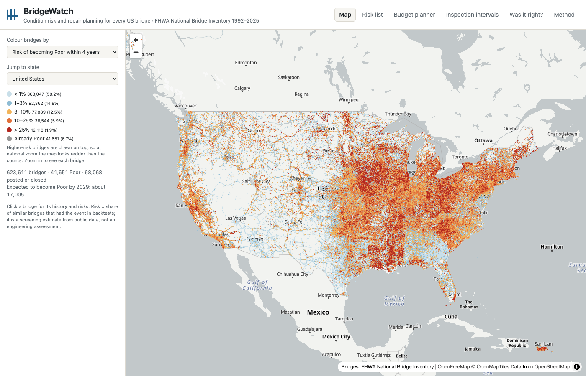
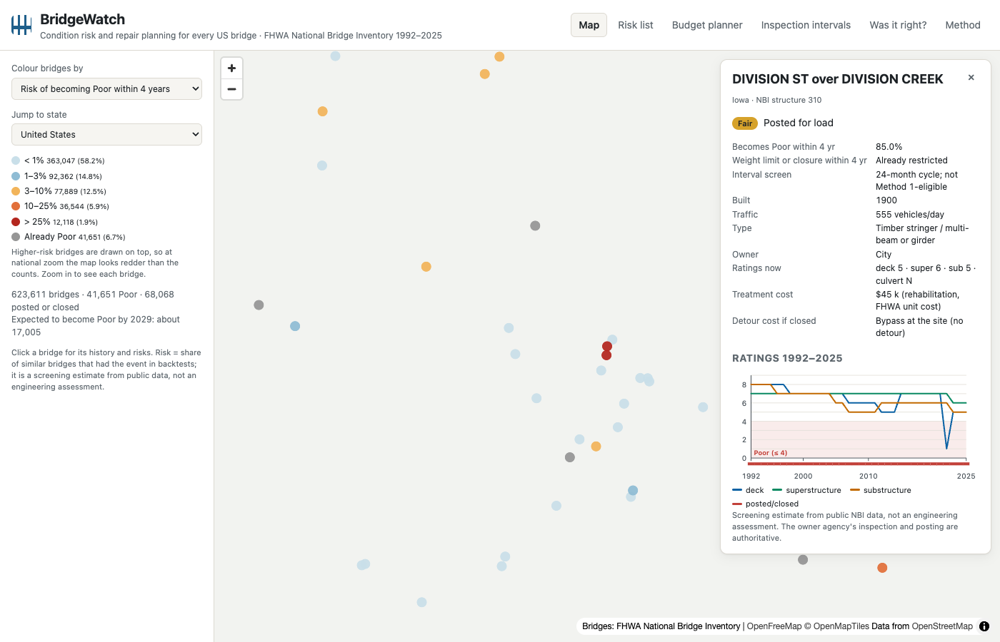
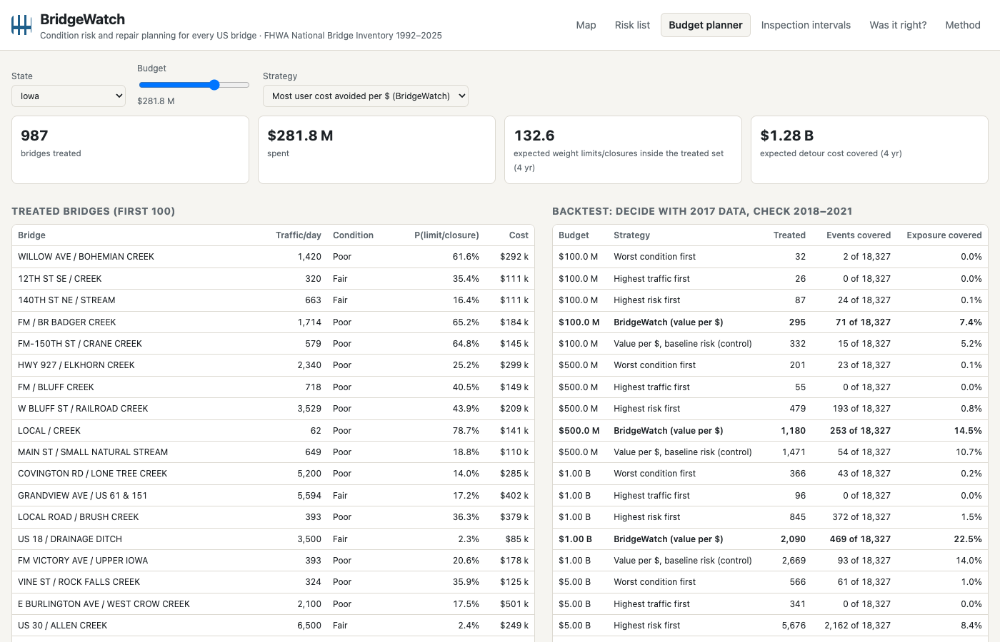

# BridgeWatch

Which US bridges will become Poor, which will get a weight limit or close, which can safely wait longer between inspections, and
where a repair budget does the most good. One open, reproducible pipeline over every bridge in the National Bridge Inventory.

## Key gap

- About 42,000 US bridges are rated Poor (6.7% in 2025), most of them owned by counties and cities with no asset-management software.
- Forecasts exist (FHWA InfoBridge, many papers), but they report one accuracy number and rarely say how much they beat
  "the rating stays the same". Over 4 years about 75% of ratings do not change, so accuracy alone flatters every model.
- The event that matters is rare: 2–5% of bridges become Poor in 4 years. Nobody publishes how well a ranked list catches it,
  or turns it into a budget decision and checks that decision against what happened.

## Fix

<!-- results:headline -->
| Question (time-split backtest) | Best existing method | BridgeWatch |
|---|---|---|
| Q1 · becomes Poor within 4 years: hit rate of the top-1% list | 24.3% (markov chain) | **30.2%** |
| Q3 · weight limit or closure within 4 years: hit rate of the top-1% list | 18.1% (time in condition) | **30.5%** |
| Q4 · 48-month interval misses, same number of bridges (2021) | 4.90% (Method 1 criteria) | **2.26%** |
| Q2 · detour exposure of real 2018–2021 closures/postings inside a $500 M programme | 10.7% (value per $ with baseline risk) | **14.5%** |
<!-- /results:headline -->

- **Q1 · becomes Poor** and **Q3 · weight limit or closure:** gradient-boosted trees on each bridge's own past only, with risk
  forced to rise as a rating gets worse. Scored against "rating stays the same", time-in-condition and a Markov chain like those
  in agency tools.
- **Q4 · inspection intervals:** for bridges on a 24-month cycle, how often a 48-month interval would have missed a drop,
  compared with our encoding of the federal Method 1 criteria.
- **Q2 · budget planner:** repair, replace or close, using FHWA 2025 replacement unit costs and federal detour-cost values,
  backtested against the real postings and closures that followed.
- **Every claim is a time-split backtest:** train only on outcomes known by the test year, plus five states (IA, TX, PA, CA, GA)
  never used in training.

## One history per bridge

Several states renumbered most of their inventory in a single year (Illinois 2013, Missouri 2001, Pennsylvania 2010 and others):
1.04 million IDs appear for about 620,000 bridges. BridgeWatch links old and new IDs (padding changes, identical physical
description, or location within 50 m, never to a structure built in the transition year), then removes any link that would give a
bridge two records in one year.

- 214,757 links; year-to-year ID breaks fall from 2.2% to 1.1%; bridges with a full 34-year history rise from 28% to 50%.
- Linked pairs behave like ordinary consecutive years: the lowest rating moves by at most one point 97–98% of the time (98% for
  unlinked consecutive years).

## Results

### Q1 and Q3: ranked risk lists

<!-- results:backtest -->
| Question | Horizon | Test year | States | Events | Best baseline, top 1% | Model, top 1% | Brier skill (best baseline → model) |
|---|---|---|---|---|---|---|---|
| Poor | 2 yr | 2019 | seen | 1.56% | 12.6% (Markov chain) | 19.4% | +0.036 → +0.052 |
| Poor | 2 yr | 2019 | holdout | 1.51% | 15.7% (Markov chain) | 18.9% | +0.041 → +0.056 |
| Poor | 2 yr | 2023 | seen | 1.60% | 13.5% (Markov chain) | 18.9% | +0.040 → +0.058 |
| Poor | 2 yr | 2023 | holdout | 1.01% | 12.0% (Markov chain) | 14.8% | +0.033 → +0.050 |
| Poor | 4 yr | 2017 | seen | 3.27% | 24.2% (Time in condition) | 33.9% | +0.066 → +0.107 |
| Poor | 4 yr | 2017 | holdout | 3.42% | 30.8% (Time in condition) | 34.4% | +0.082 → +0.086 |
| Poor | 4 yr | 2021 | seen | 3.05% | 24.3% (Markov chain) | 30.2% | +0.068 → +0.091 |
| Poor | 4 yr | 2021 | holdout | 2.36% | 26.3% (Markov chain) | 28.4% | +0.074 → +0.103 |
| Poor | 8 yr | 2013 | seen | 6.53% | 42.2% (Markov chain) | 46.2% | +0.106 → +0.134 |
| Poor | 8 yr | 2013 | holdout | 6.35% | 51.6% (Time in condition) | 47.3% | +0.140 → +0.140 |
| Poor | 8 yr | 2017 | seen | 6.16% | 38.9% (Time in condition) | 48.2% | +0.100 → +0.145 |
| Poor | 8 yr | 2017 | holdout | 5.71% | 48.1% (Time in condition) | 54.1% | +0.132 → +0.159 |
| Limit/closure | 2 yr | 2019 | seen | 1.80% | 12.4% (Time in condition) | 28.4% | +0.022 → +0.065 |
| Limit/closure | 2 yr | 2019 | holdout | 1.26% | 11.9% (Time in condition) | 23.5% | +0.029 → +0.077 |
| Limit/closure | 2 yr | 2023 | seen | 1.24% | 10.4% (Time in condition) | 19.0% | +0.017 → +0.029 |
| Limit/closure | 2 yr | 2023 | holdout | 1.03% | 8.4% (Rating stays the same) | 10.7% | +0.008 → +0.023 |
| Limit/closure | 4 yr | 2017 | seen | 3.64% | 18.9% (Time in condition) | 37.2% | +0.035 → +0.084 |
| Limit/closure | 4 yr | 2017 | holdout | 2.60% | 22.5% (Time in condition) | 47.7% | +0.055 → +0.122 |
| Limit/closure | 4 yr | 2021 | seen | 2.59% | 18.1% (Time in condition) | 30.5% | +0.033 → +0.075 |
| Limit/closure | 4 yr | 2021 | holdout | 1.68% | 13.1% (Rating stays the same) | 19.8% | +0.017 → +0.043 |
<!-- /results:backtest -->

Brier skill is relative to the training base rate. "Top 1%" = share of the 1% highest-risk bridges that actually had the event.
Where the model does not clearly beat the best baseline, the table shows it (8-year Poor, 2013, held-out states).

### Q4: inspection-interval screen

<!-- results:screen -->
| Base year | On 24 months | Miss rate, all | Method 1: bridges / miss | Model, same count: miss | Method 1 minus riskiest 10%: miss |
|---|---|---|---|---|---|
| 2015 | 518,462 | 20.57% | 218,151 / 6.94% | 3.50% | 5.14% |
| 2017 | 524,101 | 21.08% | 221,154 / 7.23% | 3.18% | 5.30% |
| 2019 | 524,867 | 19.83% | 218,961 / 5.72% | 2.48% | 3.74% |
| 2021 | 522,798 | 19.33% | 212,613 / 4.90% | 2.26% | 3.06% |
<!-- /results:screen -->

A miss = within 4 years the bridge became Poor, was posted or closed, or a component rating fell 2+ points. Interval decisions
belong to the bridge owner; this is evidence for an agency's own Method 1 or Method 2 policy.

### Q2: budget planner

<!-- results:plan -->
Decision year 2017, 539,140 open bridges; 18,327 were posted, restricted or closed in 2018–2021.

| Budget | Strategy | Bridges treated | Events inside treated set | Share of event detour exposure |
|---|---|---|---|---|
| $100 M | Worst condition first | 32 | 2 | 0.0% |
| $100 M | Highest traffic first | 26 | 0 | 0.0% |
| $100 M | Highest risk first | 87 | 24 | 0.1% |
| $100 M | BridgeWatch (value per $) | 295 | 71 | 7.4% |
| $100 M | Value per $, baseline risk (control) | 332 | 15 | 5.2% |
| $500 M | Worst condition first | 201 | 23 | 0.1% |
| $500 M | Highest traffic first | 55 | 0 | 0.0% |
| $500 M | Highest risk first | 479 | 193 | 0.8% |
| $500 M | BridgeWatch (value per $) | 1,180 | 253 | 14.5% |
| $500 M | Value per $, baseline risk (control) | 1,471 | 54 | 10.7% |
| $1.0 B | Worst condition first | 366 | 43 | 0.2% |
| $1.0 B | Highest traffic first | 96 | 0 | 0.0% |
| $1.0 B | Highest risk first | 845 | 372 | 1.5% |
| $1.0 B | BridgeWatch (value per $) | 2,090 | 469 | 22.5% |
| $1.0 B | Value per $, baseline risk (control) | 2,669 | 93 | 14.0% |
| $5.0 B | Worst condition first | 566 | 61 | 1.0% |
| $5.0 B | Highest traffic first | 341 | 0 | 0.0% |
| $5.0 B | Highest risk first | 5,676 | 2,162 | 8.4% |
| $5.0 B | BridgeWatch (value per $) | 9,224 | 1,763 | 41.8% |
| $5.0 B | Value per $, baseline risk (control) | 9,833 | 388 | 28.3% |
<!-- /results:plan -->

This measures targeting: whether the money went to the bridges that were about to be posted or closed. It cannot show whether a
given repair would have prevented that.

## Website

`web/` is a static site (no server): a map of every bridge coloured by condition or risk, each bridge's 1992–2025 rating history,
risk lists by state and owner, the budget planner, the interval screen and the backtest pages.

```bash
uv run bridgewatch export          # writes web/data from data/scores_2025.parquet
python -m http.server -d web 8000  # then open http://localhost:8000
```

`web/data/` is generated (about 240 MB on disk, 37 MB gzipped as served) and is not committed.

The map uses OpenFreeMap street tiles when it can reach them. Where it can't (offline, or a host that blocks other sites), it
falls back to a built-in basemap in `web/basemap/` (states, counties, highways, rivers, lakes, city and county names; about 10 MB),
built by `uv run python scripts/build_basemap.py`. Open the page with `#builtin-map` to see it. `scripts/build_artifact.py`
packages the site for single-page hosting (inline CSS, point file as base64 text).

| Map: risk of becoming Poor | Bridge detail | Budget planner |
|---|---|---|
|  |  |  |

## Quick start

```bash
uv sync --dev
uv run pytest -q
uv run bridgewatch download --years 2024-2025   # a small slice
```

## Reproduce the results

```bash
scripts/reproduce.sh                # downloads ~1.7 GB from FHWA, then every step below
uv run python scripts/readme_tables.py
```

| Step | Command | Output |
|---|---|---|
| Download 1992–2025 | `bridgewatch download` | `data/raw/*.zip`, `manifest.json` (SHA-256) |
| Parse | `bridgewatch panel` | `data/panel/nbi_{year}.parquet` |
| Link IDs | `bridgewatch link` | `data/panel_keyed/`, `data/id_links.parquet` |
| Data quality | `bridgewatch quality` | `reports/data_quality.md` |
| Labels and features | `bridgewatch labels`, `features` | `data/labels.parquet`, `data/features.parquet` |
| Q1 + Q3 backtest | `bridgewatch backtest` | `reports/backtest.md` |
| Q4 and Q2 backtests | `bridgewatch screen`, `plan` | `reports/screen.json`, `reports/plan.json` |
| Score 2025, export site | `bridgewatch score`, `export` | `data/scores_2025.parquet`, `web/data/` |

## Limits

- Condition ratings are visual and vary between inspectors; FHWA's own study found 95% of ratings within ±2 points of the mean.
- Repairs are not recorded in the NBI; they are inferred from rating jumps and used only to explain label noise.
- 2025 is the last year in the old Coding Guide format; forecasting from 2026 SNBI data needs the FHWA crosswalk.
- The Method 1 encoding and the detour-cost values (taken from Caltrans' copy of the USDOT benefit-cost tables) should be checked
  against the primary documents before any agency use.
- Not an engineering assessment of any bridge. The owner agency's inspection and posting are authoritative.

## Data and licence

Bridge data: FHWA National Bridge Inventory (US federal data). Unit costs: FHWA Bridge Replacement Unit Costs 2025.
Built-in basemap: US Census boundaries via us-atlas 3.0.1 (ISC licence) and Natural Earth 1:10m (public domain).
Code: MIT licence, see `LICENSE`.
